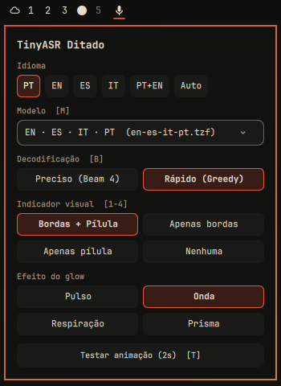

# TinyASR Dictation Indicator

An Omarchy Shell (`Quickshell`) plugin that provides an active-window **edge glow**, a floating **listening/transcribing pill**, and a **settings panel** for on-device [tinyasr](https://github.com/dkaraush/tinyasr) voice dictation.



## Features

- **Active-window indicator**: Renders a smooth pulsing edge glow and/or floating pill centered on the focused Hyprland window (with automatic screen fallback).
- **Theme-synced & multilingual**: Uses `qs.Commons` (`Color.accent`, `Color.popups.*`, `Style.duration`, `Style.font`) and `Commons.Translations` (`en`, `pt`, `es`, `it`), following Omarchy's language setting live.
- **Bar widget & keyboard panel**:
  - **Language**: `PT`, `EN`, `ES`, `IT`, `PT+EN`, `Auto` (adapts to the selected model).
  - **Model** (`M`): Switch between `en-es-it-pt.tzf`, `en-ru-uk.tzf`, `uz.tzf`, `en-fa.tzf`, and `en-km.tzf`.
  - **Decoding** (`B`): Accurate (`Beam 4`) or Fast (`Greedy / Beam 1`).
  - **Visual indicator** (`1–4`): `Edges + Pill`, `Edges only`, `Pill only`, or `None`.
  - **Preview** (`T` or right-click on the bar icon): 2-second animation preview.

## Requirements

- Omarchy with `omarchy-shell`, `hyprctl`, and `omarchy-clipboard-paste-text`.
- `python3` (used by `scripts/tinyasr-config` for bounded config and active-window I/O).
- `cargo` / `rustc` (to build `tinyasr-cli` from source).
- `pw-record` (PipeWire) or `parecord` (PulseAudio) for microphone capture.

---

## Full Installation

### 1. Install the plugin

```bash
omarchy plugin add https://github.com/jvlianodorneles/tinyasr-indicator.git --enable
omarchy bar put dorneles.tinyasr-indicator --section right
```

### 2. Install `tinyasr` and models

Clone [`dkaraush/tinyasr`](https://github.com/dkaraush/tinyasr) and extract the default model (`en-es-it-pt.tzf`) and Silero VAD:

```bash
mkdir -p ~/Projects ~/.local/share/tinyasr/models ~/.local/bin
git clone --depth 1 https://github.com/dkaraush/tinyasr ~/Projects/tinyasr
gzip -dc ~/Projects/tinyasr/models/en-es-it-pt.tzf.gz > ~/.local/share/tinyasr/models/en-es-it-pt.tzf
gzip -dc ~/Projects/tinyasr/models/silero_vad.onnx.gz > ~/.local/share/tinyasr/models/silero_vad.onnx
```

*(Optional)* Extract additional models if you plan to switch to them in the panel:

```bash
for m in en-ru-uk.tzf uz.tzf en-fa.tzf en-km.tzf; do
  gzip -dc ~/Projects/tinyasr/models/${m}.gz > ~/.local/share/tinyasr/models/${m}
done
```

### 3. Build and install `tinyasr-cli`

Create a small Rust wrapper crate at `~/Projects/tinyasr-cli` that links against `~/Projects/tinyasr` and build it in release mode:

```bash
mkdir -p ~/Projects/tinyasr-cli/src
cat > ~/Projects/tinyasr-cli/Cargo.toml <<'EOF'
[package]
name = "tinyasr-cli"
version = "0.1.0"
edition = "2024"

[dependencies]
tinyasr = { path = "../tinyasr" }

[profile.release]
opt-level = 3
lto = "thin"
codegen-units = 1
EOF
```

Add `~/Projects/tinyasr-cli/src/main.rs` (accepting `--raw`, `--lang`, `--model`, `--vad`, `--beam`) and build:

```bash
cargo build --release --manifest-path ~/Projects/tinyasr-cli/Cargo.toml
cp ~/Projects/tinyasr-cli/target/release/tinyasr-cli ~/.local/bin/tinyasr-cli
ln -sf tinyasr-cli ~/.local/bin/tinyasr
```

> **Note:** Omarchy's Hyprland dictation check (`o.dictation_installed()`) looks for a binary named `tinyasr` in `PATH`, so the `tinyasr -> tinyasr-cli` symlink is required.

### 4. Install the Omarchy dictation adapter

Create `~/.local/bin/omarchy-dictation-tinyasr` (`chmod +x`) handling `start`, `stop`, and `toggle` (recording 16 kHz mono s16 PCM via `pw-record`, transcribing with `tinyasr-cli`, notifying `omarchy-shell tinyasr-indicator`, and pasting with `omarchy-clipboard-paste-text --universal`), then activate `tinyasr` as your dictation backend:

```bash
omarchy-dictation-use tinyasr
omarchy-restart-hyprctl
```

### 5. Keyboard shortcuts (Hyprland)

Once `tinyasr` is active, Omarchy binds by default:
- **`Alt + Space`**: Toggle dictation (`omarchy-dictation toggle`)
- **Hold `Right Alt`**: Push-to-talk (`omarchy-dictation start` / `stop`)

To configure a custom activation key, edit `~/.config/hypr/bindings.lua` and run `omarchy-restart-hyprctl` to apply the changes:

- **Custom push-to-talk key** (for example, **Right Ctrl** `Control_R`, or **AltGr** `ISO_Level3_Shift` on `br` / `us-intl` layouts where Right Alt is AltGr):

```lua
if o.dictation_installed() then
  o.bind_hold(
    "Control_R",
    "Start dictation (push-to-talk, Right Ctrl)",
    "omarchy-dictation start",
    "Stop dictation (push-to-talk, Right Ctrl)",
    "omarchy-dictation stop",
    { ignore_mods = true, non_consuming = true, transparent = true }
  )
end
```

  > Replace `"Control_R"` with `"ISO_Level3_Shift"` (for AltGr) or any key name accepted by Hyprland. `non_consuming = true` and `transparent = true` keep normal modifier combinations (such as `Ctrl + C`) working as usual.

- **Custom toggle shortcut** (to replace `Alt + Space`, unbind the default first and bind your preferred combination):

```lua
hl.unbind("ALT + SPACE")
o.bind("SUPER + ALT + D", "Toggle dictation", "omarchy-dictation toggle")
```

---

## Uninstallation

### 1. Remove the plugin

```bash
omarchy bar remove dorneles.tinyasr-indicator
omarchy plugin remove dorneles.tinyasr-indicator
```

### 2. Remove `tinyasr` dictation binaries, models, and config

```bash
rm -f ~/.local/bin/tinyasr ~/.local/bin/tinyasr-cli ~/.local/bin/omarchy-dictation-tinyasr
rm -rf ~/.local/share/tinyasr ~/.config/tinyasr
```

The source directories `~/Projects/tinyasr` and `~/Projects/tinyasr-cli` (which contains your local Rust wrapper source) are left untouched so local edits are not lost. If you no longer need them after reviewing/backing up any changes, remove them manually.

If `tinyasr` was your active dictation backend, clear or switch it:

```bash
rm -f ~/.config/omarchy/defaults/dictation
omarchy-restart-hyprctl
```

*(If you added the `ISO_Level3_Shift` binding to `~/.config/hypr/bindings.lua`, remove those lines as well.)*

---

## IPC

```bash
omarchy-shell tinyasr-indicator listening
omarchy-shell tinyasr-indicator transcribing
omarchy-shell tinyasr-indicator hide
omarchy-shell tinyasr-indicator preview
omarchy-shell tinyasr-indicator status
```

Settings are persisted under `~/.config/tinyasr/` (`indicator-style`, `model`, `lang`, `beam`).

## License

This plugin is licensed under the [MIT License](LICENSE).  
The underlying [`tinyasr`](https://github.com/dkaraush/tinyasr) library and its pre-trained models are licensed under `GPL-3.0-or-later`.
